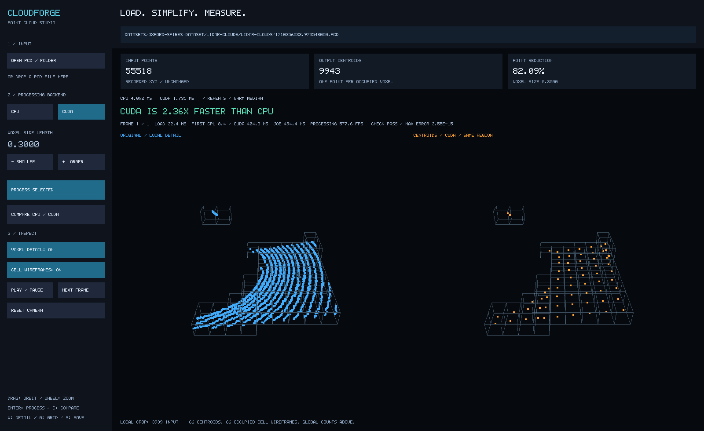

# cloudForge Studio

C++20 / CUDA point-cloud processing with a desktop input workflow, voxel-grid
centroids, CPU/GPU correctness comparison and measured performance.



## Use the app

From Ubuntu in the project directory:

```bash
bash scripts/run-demo.sh
```

This opens an empty studio; no dataset path is hardcoded by the launcher.

1. Select **CPU** or **CUDA**.
2. Click **Open PCD / Folder**. Navigate directories, choose a `.pcd` file, or
   select **Use this folder** for a sequence. You can also paste a path into the
   top field and press Enter, or drop a file onto the window. Windows paths such
   as `D:\Annie-Proj\CloudForge\...` are converted to WSL paths.
3. Selecting input processes the **selected backend only**, on a background worker.
4. Adjust voxel size with Smaller/Larger, then click **Process selected** to apply.
5. Open **Benchmark window** to compare the input already loaded in the main window.
6. Enable **Voxel detail** to inspect the same local region in both panels, with
   real occupied-cell wireframes and one representative centroid per cell.

The ordinary no-argument app defaults to voxel size 0.3. A CLI input defaults to
0.1 unless `--voxel` is given. Smaller voxels preserve more samples; larger voxels
make density reduction more visible, at the cost of more geometric detail.
The shape is expected to remain similar: downsampling reduces samples, not the
identity of the scanned scene. Original points are never modified.

Global point counts are shown above the views. Detail mode explicitly labels its
local crop and local point counts. Both panels use identical cameras and point
sizes. Wireframes are actual occupied cells in the inspected region, not every
empty cell or every global cell. Full-cloud mode shows all input/output points.

| Control | Action |
|---|---|
| Open / O | In-app file and folder browser |
| Top path field | Type/paste path; Ctrl+A clears; Enter loads |
| CPU / CUDA | Select and process that backend if input is loaded |
| Process / Enter | Run selected backend only |
| Benchmark window / C | Open settings and results together in a second window |
| Smaller/Larger, +/- | Change configured voxel size; Process applies it |
| Voxel detail / V | Toggle local voxel inspection |
| Cell wireframes / G | Toggle actual occupied-cell outlines |
| Play / Space | Fixed-rate ordered playback; restart at end |
| Next / N | Advance one frame |
| Left drag / wheel | Synchronized orbit / zoom |
| Right or middle drag / Shift + left drag | Synchronized pan |
| Reset / R | Reset both cameras |
| S | Save BMP to `build/cloudforge.bmp`, or `--screenshot` path |
| Escape | Close browser/editor, or exit the app |

Comparison uses repeated warmed calls (default five), alternating order, and
per-backend medians. It excludes disk loading/rendering but includes host
validation, transfers and completed GPU output. GPU memory is reused across jobs
on the worker. The first call per backend and total job time (including warm-up,
repeats and loading) are displayed separately, so CUDA startup is not hidden.
Processing FPS is reciprocal processing latency, not display/playback FPS.
No winner is accepted when CPU/GPU correctness fails; differences within 1% are
reported as approximately equal. Timings are measurements for this machine/input,
not a promise that CUDA wins on every cloud.

## Build

Ubuntu CPU prerequisites:

```bash
sudo apt update
sudo apt install build-essential cmake ninja-build libgtest-dev
```

Viewer prerequisites:

```bash
sudo apt install libglfw3-dev libgl1-mesa-dev
```

Open3D/PCL are not required. The desktop renderer uses GLFW/OpenGL. CUDA is optional.
In WSL, keep the Windows NVIDIA GPU driver; do not install a Linux display driver.
See [NVIDIA's WSL guide](https://docs.nvidia.com/cuda/wsl-user-guide/).

CPU-only Release build (no CUDA/compiler detection or graphics dependency):

```bash
cmake --preset cpu-release
cmake --build --preset cpu-release
ctest --preset cpu-release
```

CUDA studio build on the development machine:

```bash
export PATH="/usr/local/cuda-13.2/bin:$PATH"
cmake --preset cuda-release
cmake --build --preset cuda-release
ctest --preset cuda-release
```

Tested on Ubuntu 26.04 / WSL2, GCC 15.2, CMake 4.2.3, CUDA 13.2.86 and RTX 4050
Laptop GPU. The preset targets the detected GPU; use
`-DCMAKE_CUDA_ARCHITECTURES=89` for a fixed RTX 4050 build target.
Set `-DCLOUDFORGE_BUILD_VIEWER=OFF` for headless CUDA; `-DBUILD_TESTING=OFF` removes
the GoogleTest requirement. Dependencies are not downloaded automatically.
MSVC warning flags are configured, but native Windows builds are not validated.

## CLI / automated checks

Optional preselected input:

```bash
./build/demo/cloudforge_viewer "DataSets/Oxford-Spires=Dataset/lidar-clouds/lidar-clouds" \
    --backend cuda --voxel 0.3 --frames 30
```

A headless benchmark automatically measures both backends if CUDA is compiled:

```bash
./build/demo/cloudforge_benchmark "DataSets/Oxford-Spires=Dataset/lidar-clouds/lidar-clouds" \
    --frames 30 --repeat 7 --voxel 0.1 --csv benchmarks/my-run.csv
```

Automated studio comparison, detail view, screenshot, then exit:

```bash
./build/demo/cloudforge_viewer "DataSets/Oxford-Spires=Dataset/lidar-clouds/lidar-clouds/1710256033.970548000.pcd" \
    --backend cuda --voxel 0.3 --compare on --detail on --repeat 7 \
    --smoke-frames 1 --screenshot build/demo/studio-detail.bmp
```

`--frames` limits a directory sequence; files are numerically timestamp-sorted,
not recursively searched. Playback uses configurable `--fps` (default 10), without
frame dropping; source timestamp intervals are not replayed exactly. Comparison
per frame is opt-in (`--compare on`); normal playback runs only the selection.
The default empty studio allows all discovered frames. CLI input defaults to the
first 30. WSLg/X11 is required. The tested desktop uses Mesa llvmpipe for drawing;
CUDA computation still runs on NVIDIA hardware. For display failures try
`LIBGL_ALWAYS_SOFTWARE=1` before the launch command.

## Measured optimization

The initial CUDA implementation was slower. Nsight Systems identified repeated
allocation/synchronization and triple-key comparison sorting. The optimized path
reuses device/scratch buffers, uses validated collision-free integer keys and CUB
radix sort, and fuses key/aggregate generation in a custom kernel. Wide coordinate
ranges retain a full triple-key fallback instead of hashing or truncating keys.

| Run: 30 frames, 7 repeats, voxel 0.1 | CPU median ms | CUDA median ms |
|---|---:|---:|
| Initial implementation | 5.905 | 7.326 |
| Optimized implementation | 6.457 | 1.937 |

In the optimized run, the ratio of these medians was **3.33x** in CUDA's favor.
Both backends agreed on all 30 frames. At voxel 0.3, another 30-frame run measured
CPU 3.939 ms and CUDA 2.322 ms (1.70x). Clocks/power were not controlled and runs
occurred at different times; compare each run's paired CPU/GPU measurements rather
than treating CPU timing changes as an algorithm change.
Raw CSVs and profiler summaries are in `benchmarks/`.
See [performance evidence](docs/performance.md) and [design decisions](docs/design.md).

## Scope and data

The loader supports uncompressed little-endian binary PCD with scalar float32
XYZ, including padding and reordered fields. It rejects malformed/nonfinite
frames. Other attributes are skipped. ASCII/compressed PCD, live sensors, RGB
processing, and multiple GPU devices per worker are not supported in this version.
The fast GPU workspace grows to its high-water capacity and remains allocated
until the worker/thread exits. First-call/context initialization costs can be much
larger than warmed processing time. The wide-range fallback is correct but does
not share the fast path's performance guarantees.

35 CPU/loader/workflow tests plus six CUDA tests cover core correctness, invalid
input, workspace reuse/growth, extreme signed offsets and safe range fallback.
CPU/GPU centroids use absolute and relative tolerance `1e-10`, rather than bitwise
comparison. This is tested evidence, not proof for every possible floating-point
input or machine.

Demo data: [Oxford Spires Dataset](https://dynamic.robots.ox.ac.uk/datasets/oxford-spires/),
Tao et al., *The Oxford Spires Dataset: Benchmarking Large-Scale LiDAR-Visual
Localisation, Reconstruction and Radiance Field Methods*, IJRR, 2025.
Its **CC BY-NC-SA 4.0** / non-commercial academic-use terms are separate from this
repository's MIT code license. Download data separately into ignored `DataSets/`;
do not commit datasets or ZIPs. Tests generate their own small files.

## Benchmark and Results window

Load a file or sequence once in the main window. Click Benchmark Window (C) to
open a second native window with settings on the left and graphs/results on the
right. There is no second PCD selection or CSV filename requirement.
The benchmark window starts at 1100 x 780 and supports normal edge/corner resizing
(minimum 960 x 740). Main-screen verdicts use plain language such as "CUDA is
1.71x faster than CPU" instead of displaying the CPU/CUDA formula.

Choose This Frame (default) to benchmark the current frame, using a snapshot of
its loaded point data. Sequence uses the loaded, timestamp-ordered frame list,
limited by Max Sequence Frames. Set voxel size, measured repeats (minimum 10), and
warm-ups. Defaults are 30 repeats and 3 warm-ups per backend per frame.
Ctrl+A clears a field, Ctrl+V pastes, and Enter ends editing.

Run Again / Benchmark always performs a fresh calculation. Each run saves its raw
CSV automatically under build/benchmarks/ with a distinct filename. An existing
file never prevents processing or gets overwritten; CLI runs also choose a fresh
sibling filename if the requested output already exists. Report filenames appear
above the graphs. No previous CSV is used as a calculation cache.

Both windows pause rendering and playback during measurements while events and
cancellation remain active. Progress appears in the benchmark window title.
Cancel stops after the current backend pair/call. Closing the benchmark window
hides it without closing the main app; reopening reuses the window. Closing the
main app cancels pending benchmark work and waits for the current call to finish.

After completion, the main screen shows this frame's benchmark CPU/CUDA medians,
ratio and processing FPS. Changing voxel size in the benchmark also updates the
main app and regenerates its simplified view after measurement. Main metrics are
matched by frame and voxel size; loading a new input clears the previous report.

Warm-ups always run CPU then CUDA, independently of the inspection backend.
Measured pairs alternate order. Each pair is checked outside the timer. Timing
includes a completed host-to-host backend call: validation, transfers, required
allocation and GPU synchronization. Loading, rendering, checks and CSV writing
are excluded. Startup warm-up costs are excluded; GPU buffers persist. Use AC
power and close other viewer instances and heavy applications before measuring.
Natural clock and OS variation remains; no benchmark guarantees a constant ratio.

## Reading graphs and CSV samples

- Upper graph: X is frame number in temporal order; Y is processing time in
  milliseconds. Blue is CPU and orange is CUDA. Lower time is better. Each point
  is a frame's median across repetitions; whiskers span its P10-P90 timings.
- Lower graph: X is frame number; Y is CPU median divided by CUDA median, in x
  times. Above the gold 1x line favors CUDA; below favors CPU. One frame uses bars;
  a sequence uses curves. Empty frames have no speedup point.
- Hover either graph to inspect a frame's filename, input/output counts, medians
  and repetitions. P10-P90 describes variation, not confidence. For long reports,
  at most 300 frame positions are displayed with a labeled stride; CSV retains all.
- CSV Samples shows the individual repetitions with pagination. Header speedup
  uses pooled medians and can differ from an individual frame's speedup. No
  speedup claim is shown for cancelled, failed or CPU-only reports.

Schema 1 CSV includes timing scope, settings, build/compiler, timestamp, and thread
count metadata followed by one row per repetition with point counts, execution
order, CPU/CUDA milliseconds, maximum error and correctness. Up to 200000 pairs
are allowed per report. Older committed summary CSVs retain their original schema.
To view a saved raw schema 1 report without rerunning it:

```bash
./build/demo/cloudforge_viewer . --results-csv build/benchmarks/benchmark.csv
```

The CLI benchmark uses the same runner with --frames, --repeat, --warmup, --voxel
and optional --csv. Malformed reports and nonfinite timings produce visible errors.

## Recorded point-cloud playback

Each timestamped PCD is one 3D frame, rather than a conventional video image.
Select CPU or CUDA, open the folder of frames, and choose Use This Folder.
If a single PCD is already loaded, Play Clip loads the other PCD frames in its
containing folder and begins at the selected file. A folder with only one PCD
shows an explicit message that more recorded frames are needed for animation.
Sequences start playing automatically. Both panels update together: original
recorded frame on the left and that same frame downsampled by the selected backend
on the right. The displayed frame number always belongs to the visible pair,
even while the next frame is being processed in the background.

The single playback bar below the views provides Play/Pause (Space), Previous,
Next (N), Restart, Loop and target-FPS minus/plus controls. Default target is 10
FPS; actual playback FPS is measured separately. Each frame is processed once,
without benchmark repetitions or CPU/GPU comparison work. Loading and rendering
can limit the achieved rate; no frames are skipped to manufacture the target FPS.
Playback uses a configurable fixed rate, not exact source timestamp intervals.

A folder containing PCDs is one clip. A parent folder with no PCDs of its own can
contain separate clip folders: clips play in folder-name order and frames within
each clip play in numeric timestamp order. Only immediate clip folders are scanned.
The clip name and filename appear above the playback bar. Loop returns to the
first frame after the last clip. Camera framing stays fixed within a clip and
refits on clip transitions; orbit, pan and zoom remain synchronized between panels.
Opening Benchmark pauses playback so timing stays separate from the animation.

## Native Windows qualification (21 October 2026)

The CPU application has been built and run natively using MSVC 2022 x64 Release.
All 35 shared tests passed, and 60 real PCD frames were processed and captured.
The native OpenGL renderer was AMD Radeon Graphics. Windows CUDA configure was
attempted and stopped with "No CUDA toolset found"; native Windows GPU processing
is not yet verified. The separate WSL CUDA build passed all 41 tests.

```powershell
cmake --preset windows-cpu-release
cmake --build --preset windows-cpu-release
ctest --preset windows-cpu-release
powershell -File scripts/run-windows.ps1
```

First configure can download pinned GLFW 3.4 and GoogleTest 1.17.0 sources into
build/. No global dependency installation is required by this workflow. On a
computer without the MSVC runtime, install Microsoft's x64 VC++ Redistributable.
The Windows CUDA Toolkit is separate from the working WSL CUDA installation.

Deliverables are under output/: technical report and portfolio article PDFs,
captioned 1080p MP4 with editable SRT and voice-over guide, native CPU Windows ZIP,
and raw benchmark/qualification evidence. scripts/create_delivery.py rebuilds the
media using recorded app captures. --capture-dir exports a BMP after each completed
frame; capture overhead is not a processing benchmark.
