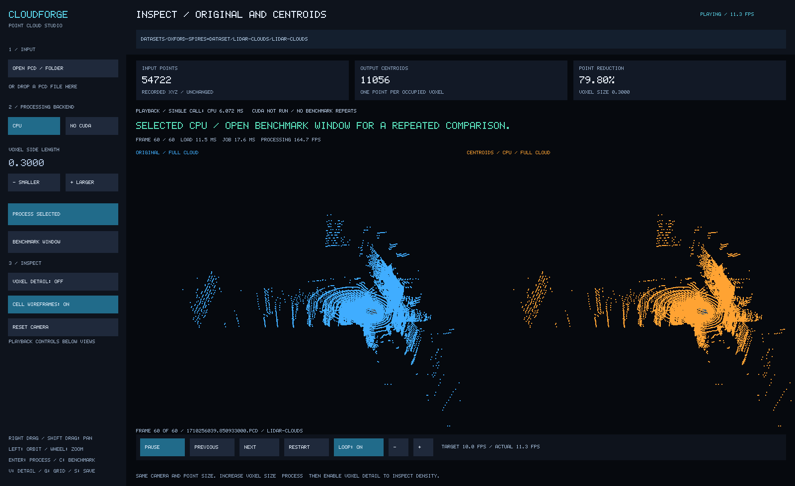

# cloudForge

**A C++20 desktop application and processing engine for simplifying and replaying recorded 3D point clouds, with a tested CPU reference and an optional CUDA backend.**

cloudForge reads PCD frames, groups nearby samples into a configurable voxel grid,
and replaces every occupied voxel with one centroid. It displays the original and
simplified frames side by side so you can inspect the density/detail tradeoff,
replay a recording, and measure CPU versus GPU processing on the same input.



*Actual native Windows CPU capture using Oxford Spires data. Dataset attribution
and visual licensing are described below.*

## Why this project exists

Dense 3D recordings contain many closely spaced samples. Processing all of them
may be unnecessary for an initial scene preview or a later geometry pipeline.
Voxel downsampling offers an explicit tradeoff: fewer representative points in
exchange for less fine detail.

cloudForge makes that tradeoff visible and measurable. It also demonstrates C++
resource ownership, validated binary input, CPU/GPU numerical comparison,
background processing, automated tests and reusable CMake builds.

## What it can do

| Capability | Current behavior |
|---|---|
| Load real scans | Read supported binary PCD files, including header padding and reordered XYZ fields. |
| Reduce density | Calculate one centroid per occupied voxel using a configurable voxel size. |
| Inspect the difference | Compare paired original/simplified views with synchronized orbit, pan and zoom. |
| Inspect individual cells | Show a labeled local crop with actual occupied-voxel wireframes. |
| Replay recordings | Play timestamp-ordered frames or consecutive clip folders, with pause, stepping, restart, loop and speed controls. |
| Choose a backend | Run the CPU reference or CUDA processing when the build includes it. |
| Benchmark the loaded input | Configure warm-ups, repetitions and frame limits in a separate resizable window. |
| Understand results | See latency/variation graphs, bar hover values, a speedup plot and raw CSV samples. |
| Recalculate and save | Every benchmark run computes fresh results and saves a separate CSV automatically. |
| Work without CUDA | Build and test the CPU engine without a CUDA installation. |

## Real-world applications

These are **potential uses of the processing approach**, not claims of deployed
customer systems or capabilities beyond this implementation.

| Area | Where cloudForge could fit | Additional work needed |
|---|---|---|
| Industrial scan review | Preview dense equipment or facility scans and inspect how much geometric detail a sampling size removes. | Domain-specific accuracy evaluation; appropriate input adapters. |
| Construction and building surveys | Explore recorded site scans before integrating reduced geometry into another workflow. | Coordinate/unit conventions, format conversion and downstream integration; no BIM generation is implemented. |
| Cultural heritage documentation | Inspect the density/detail tradeoff in recorded architectural or site geometry. | Data-use permission and evaluation of preservation requirements. |
| 3D reconstruction research | Supply a reduced point set to later registration, feature extraction or reconstruction experiments through the C++ engine. | Those downstream algorithms are not part of cloudForge. |
| GPU and systems education | Study a complete path from a reference algorithm to tested acceleration, visualization and measurement. | Independent experiments and understanding of the limitations. |

See [applications and impact](docs/applications-and-impact.md) for workflow examples,
integration boundaries, references and the measurements needed to validate a benefit.

## Demonstrated impact

- **Fewer output points:** one real frame went from **55,518 points to 9,943
  centroids** at voxel size `0.3`: an **82.09% reduction** in point count.
- **Observed processing acceleration:** a recorded WSL session over 30 frames and
  30 repetitions per backend produced CPU median **5.343 ms** and CUDA median
  **1.205 ms**, a **4.43x ratio of pooled medians**. All 900 output comparisons passed.
- **Platform evidence:** the native Windows CPU configuration passed **35 tests**
  and played 60 real frames; the WSL CUDA configuration passed **41 tests**,
  including the same 35 shared tests and six GPU tests.

The CPU baseline is a single-threaded ordered-map reference. Timings include the
completed backend call, including validation, transfers and required allocation;
they exclude loading, rendering and warm-ups. Laptop power, clocks and background
activity were not controlled. These results do not guarantee the same speedup on
another workload, prove a faster end-to-end application, or quantify memory,
storage, energy, financial or downstream accuracy benefits.

Raw data and its scope are in [performance evidence](docs/performance.md).

## Platform status

| Configuration | Status |
|---|---|
| Native Windows CPU viewer | Built and exercised with MSVC 2022 x64 Release. |
| Ubuntu/WSL CPU-only engine | Built and tested; no CUDA dependency. |
| Ubuntu/WSL CUDA viewer | Built and tested with CUDA 13.2.86 and RTX 4050 Laptop GPU. |
| Native Windows CUDA | Configure attempted; blocked by the missing Windows CUDA toolset. Not verified. |

The WSL CUDA installation is separate from a native Windows CUDA Toolkit.
Open3D and PCL are not required; the viewer uses GLFW/OpenGL.

## Build and start

Requires **CMake 3.24+**, a C++20 compiler and Git. Tests use GoogleTest; the viewer
uses GLFW/OpenGL. CUDA is optional. Complete prerequisites, CPU-only viewer builds
and troubleshooting are in [Getting started](docs/getting-started.md).

### Native Windows CPU

Requires Visual Studio 2022 with the C++ toolchain and Windows SDK. Make CMake and
Git available in the terminal. First configure can fetch GLFW 3.4 and GoogleTest
1.17.0 into `build/` if installed packages are unavailable.

```powershell
cmake --preset windows-cpu-release
cmake --build --preset windows-cpu-release
ctest --preset windows-cpu-release
powershell -File scripts/run-windows.ps1
```

### Ubuntu / WSL with CUDA

Install the prerequisites in the build guide and use the path to your installed
CUDA compiler. This example matches the tested development machine:

```bash
cmake --preset cuda-release -DCMAKE_CUDA_COMPILER=/usr/local/cuda-13.2/bin/nvcc
cmake --build --preset cuda-release
ctest --preset cuda-release
bash scripts/run-demo.sh
```

### CPU-only engine and command-line tools

```bash
cmake --preset cpu-release
cmake --build --preset cpu-release
ctest --preset cpu-release
```

This preset does not build the viewer. See the build guide to enable a CPU viewer.

## Get LiDAR data

Start with the **Oxford Spires Dataset**, used for this project's demonstration:

- [Official dataset website and download links](https://ori-drs.github.io/datasets/oxford-spires/)
- [Hugging Face dataset files](https://huggingface.co/datasets/ori-drs/oxford_spires_dataset/tree/main)
- [Official download tools and instructions](https://github.com/ori-drs/oxford_spires_dataset#download)

Choose **one sequence**, then its `raw/` LiDAR point-cloud download
(`lidar-clouds`), and extract the timestamp-named `.pcd` frames into
`DataSets/oxford-spires/`. Start with a short consecutive subset. Camera images,
ROS bags, calibration and benchmark bundles are unnecessary for cloudForge's
frame downsampling/playback workflow. Do not download the entire dataset to start.

In the app, click **Open PCD / Folder** and choose the extracted folder that
contains the `.pcd` files. One file gives a single-frame comparison; a sequence
of frames enables playback. These are 3D scans, not ordinary images or videos.

See [Dataset download and preparation](docs/datasets.md) for step-by-step
instructions, format requirements, folder layout and licensing.

## First use

1. Select **CPU** or **CUDA** in a build that supports it.
2. Click **Open PCD / Folder**, paste a path, or drop a file into the app.
3. For a recording, choose its folder and **Use this folder**. Playback starts
   automatically. With one file loaded, **Play Clip** loads neighboring frames.
4. Adjust voxel size and process the input. Use **Voxel detail** and wireframes
   to inspect the change. The original cloud is retained.
5. Open **Benchmark Window** to compare the already-loaded frame or sequence.
   Set repetitions and warm-ups, then run. Results and CSV samples appear beside
   the settings; the main screen updates with matching per-frame results.

**Voxel size uses the same distance units as the input coordinates.** A value of
`0.1` means ten centimeters only if those coordinates are in meters.

The playback bar provides Play/Pause, Previous, Next, Restart, Loop and target-FPS
controls. Target FPS, actual playback FPS and processing FPS are different metrics.
Recorded timestamps determine order; their exact time intervals are not replayed.

See the [user guide](docs/user-guide.md) for controls, folder layouts, graph axes,
supported CLI options and troubleshooting.

## Current boundaries

- Input is **uncompressed little-endian binary PCD with scalar float32 XYZ**.
  ASCII/compressed PCD, LAS/LAZ, ordinary videos and live sensor capture are unsupported.
- Extra intensity/RGB attributes are skipped, not preserved or averaged.
- The app does not implement registration, reconstruction, segmentation, defect
  detection, BIM creation or point-cloud file export. The engine returns an owned
  centroid cloud that other C++ code can use.
- Centroid downsampling can remove thin structures and small features. It is not
  lossless compression or a guaranteed noise-removal algorithm.
- Playback has no exact timestamp scheduling or bounded prefetch queue. CPU/GPU
  agreement is tolerance-based; not every numerical input or machine is proven.
- This is an engineering demonstrator, not a certified inspection system or a
  claim of industrial deployment. No robot simulation, planning or driving is included.

## Documentation

| Guide | Purpose |
|---|---|
| [Documentation index](docs/README.md) | Find the right guide for your role. |
| [Getting started](docs/getting-started.md) | Prerequisites, builds, launch and verification. |
| [User guide](docs/user-guide.md) | Input, controls, playback, benchmarking and CLI. |
| [Applications and impact](docs/applications-and-impact.md) | Practical context and honest benefit claims. |
| [Design decisions](docs/design.md) | Architecture, contracts, ownership and numerical behavior. |
| [Performance evidence](docs/performance.md) | Raw measurements, profiling and limitations. |
| [Developer ownership guide](docs/developer-ownership-guide.md) | Code walkthrough, maintenance and learning exercises. |

PDFs, a captioned demonstration MP4, voice-over scripts and a tested Windows CPU
package are published under [`output/`](output/). Raw datasets, intermediate files
and build outputs remain excluded. Media generation is separate from the C++
engine and requires additional Python/media dependencies.

## Data and license

Project code is licensed under [MIT](LICENSE). Demonstration scans come from the
[Oxford Spires Dataset](https://dynamic.robots.ox.ac.uk/datasets/oxford-spires/),
Tao et al. Its **CC BY-NC-SA 4.0** and stated non-commercial academic-use terms
are separate from the source-code license. Check the dataset's terms for your use;
do not assume the project's MIT license grants commercial rights to demo data.

Screenshots visualize that dataset and retain its attribution. Dataset-derived
visual media are shared under CC BY-NC-SA 4.0. Download data separately into ignored
`DataSets/`; do not commit scans or dataset archives. Tests generate small fixtures.
